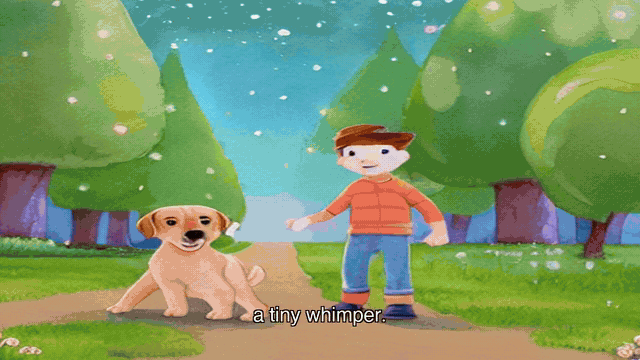
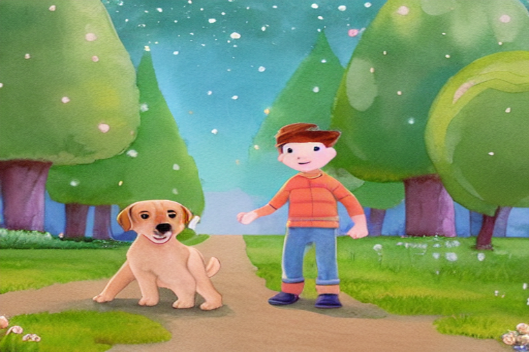
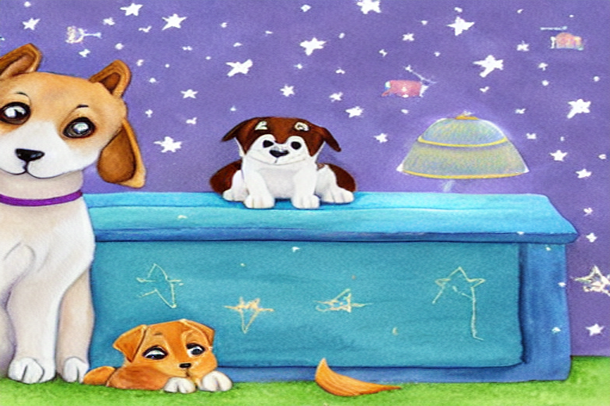

# StoryWeaver AI

**Personalized, illustrated storybooks with narration, music, PDF, and video exports.**


Enter a child's name, age, and story theme to generate a multi-page story with illustrations, spoken narration, ambient music, and synchronized subtitles.

[Output preview](#output-preview) · [Features](#features) · [Quick start](#quick-start) · [Usage](#usage) · [Evaluation](#evaluation) · [Documentation](#documentation)

## Output preview

### Story video

A **14-second excerpt** from the saved story *Liam and the Shining Lights Home*, showing generated illustrations, camera motion, and subtitles.

[](docs/media/sample-story.mp4)

The GIF is silent. [Open or download the full video with narration and music](docs/media/sample-story.mp4) (23.46 seconds).

### Story illustrations

| Page 1 | Page 2 |
|:---:|:---:|
|  |  |

[Read the sample PDF storybook](docs/media/sample-storybook.pdf) · [View the subtitles](docs/media/sample-story.srt)

These are saved outputs from the project. The GIF and compressed video preserve the generated content, including its illustration and transcription imperfections.

## Features

- **Personalized stories:** Generate 2–8 pages from a name, age, and theme.
- **Illustrations:** Create images with Stable Diffusion and story-specific prompts.
- **Narration:** Synthesize page audio with Chatterbox TTS and optional voice cloning.
- **Sound design:** Mix narration with MusicGen ambient music and optional sound effects.
- **Exports:** Produce an illustrated PDF, a narrated MP4, and SRT subtitles.
- **Evaluation:** Measure narration word error rate, latency, and structural story checks.

## Quick start

### Requirements

- A Python environment compatible with the packages in [requirements.txt](requirements.txt).
- FFmpeg: `brew install ffmpeg` on macOS or `sudo apt install ffmpeg` on Ubuntu/Debian.
- An LLM API key for story generation; a GPU is recommended for illustration and audio models.

### Installation

```bash
git clone https://github.com/sayushmaharjan/storyweaver-ai.git
cd storyweaver-ai
python -m venv .venv
source .venv/bin/activate
pip install -r requirements.txt
cp .env.example .env
```

On Windows, activate the environment with `.venv\Scripts\activate`.

Set your provider credentials in `.env`. For the included Groq configuration:

```dotenv
GROQ_API_KEY=your_groq_api_key
LLM_BASE_URL=https://api.groq.com/openai/v1
LLM_MODEL=llama-3.1-8b-instant
DEVICE=cpu
OUTPUT_DIR=outputs
```

Use `DEVICE=mps` for Apple Silicon or `DEVICE=cuda` for an NVIDIA GPU. Other supported providers include Anthropic, Hugging Face, and OpenAI-compatible endpoints; see [.env.example](.env.example) for the available key fields.

```bash
python storybook_generator/app.py
```

Open `http://localhost:7860`.

## Usage

### Web interface

1. Enter a child's name and age.
2. Choose a theme and number of pages.
3. Optionally provide a reference voice and adjust the LLM settings.
4. Generate the storybook, then preview and download the PDF and video.

### Command line

```bash
python storybook_generator/cli.py \
  --name Lily --age 5 \
  --theme "a little dragon who learns to share" \
  --pages 4
```

Add `--voice-ref /path/to/reference.wav` for a reference voice, or use `--output my-story` to change the output directory.

### Python API

```python
from storybook_generator.config import StorybookConfig
from storybook_generator.pipeline.orchestrator import StorybookOrchestrator

config = StorybookConfig.from_env()
creator = StorybookOrchestrator(
    api_key=config.best_api_key(),
    device=config.device,
    output_dir=config.output_dir,
    llm_base_url=config.llm_base_url,
    llm_model=config.llm_model,
)
result = creator.generate_storybook(
    child_name="Lily",
    age=5,
    theme="a little dragon who learns to share",
    num_pages=4,
)
print(result["pdf_path"])
print(result["video_path"])
```

## How it works

```text
Name + age + theme
    --> LLM story and illustration prompts
    --> Stable Diffusion illustrations
    --> Chatterbox narration + MusicGen ambient audio + sound effects
    --> Audio mixing + PDF rendering + video rendering
    --> PDF + MP4 + SRT
```

Generated files are stored under `outputs/`:

```text
outputs/
├── images/                 # Per-page illustrations
├── audio/
│   ├── narration/          # Per-page speech
│   ├── mixed/              # Speech, music, and effects
│   └── ambient_music.wav
├── pdf/                    # Illustrated storybooks
├── video/                  # Narrated videos and subtitles
└── evaluation_report.json  # Created by the evaluator
```

## Evaluation

Install the additional evaluation dependencies, then run:

```bash
pip install openai-whisper jiwer
python storybook_generator/evaluate.py \
  --name Lily --age 5 \
  --theme "a little dragon who learns to share" \
  --pages 2
```

The [saved evaluation report](docs/media/evaluation-report.json) records the following results for a separate two-page story about Lily and a dragon:

| Metric | Recorded result |
|---|---:|
| Mean page word error rate | 0.96% |
| Mean page transcription accuracy | 99.04% |
| Story generation latency | 1.30 s |
| Mean narration latency per page | 66.41 s |
| Structural story checks | 10/10 |

The structural score checks the name, theme, page count, sentence length, and ending mood. These results describe that saved run and are separate from the Liam video shown above.

## Troubleshooting

| Issue | What to check |
|---|---|
| Missing API key | Fill in `.env` for the selected LLM provider. |
| GPU memory exhausted | Lower the workload or use `DEVICE=cpu` for supported components. |
| Gradient images | Inspect the illustration logs; gradient pages are the fallback when generation fails. |
| Silent narration | Check that `chatterbox-tts` and its models load successfully. |
| Evaluation imports fail | Install `openai-whisper` and `jiwer`. |

## Documentation

- [Technical documentation](storybook_generator/DOCUMENTATION.md): architecture, module reference, and configuration.
- [Environment template](.env.example).
- [Sample provenance](docs/media/README.md): source files and video conversion details.
- [Dependencies](requirements.txt).

## License

The project documentation designates the code as MIT-licensed for educational and research use. Model weights and third-party assets remain subject to their own terms.
